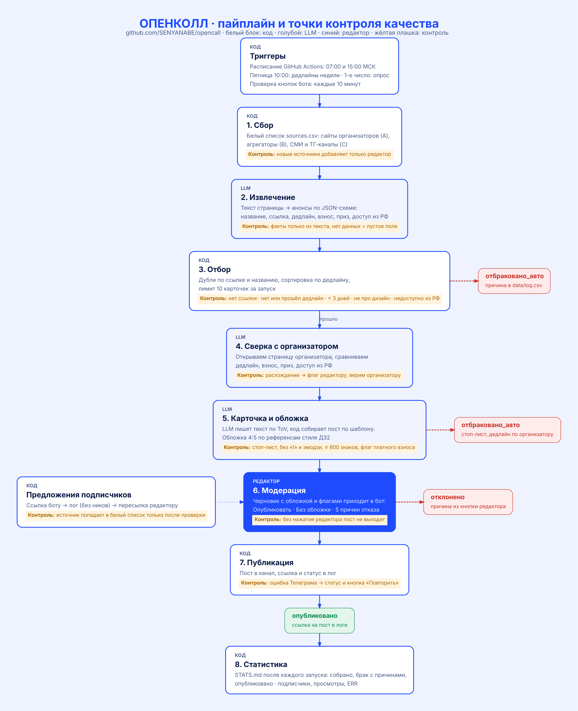

# ОПЕНКОЛЛ

ИИ-лента возможностей для дизайнеров в Телеграме: конкурсы, гранты, резиденции, тендеры и опенколлы из России и мира.

Этот репозиторий и есть медиа-пайплайн: код, белый список источников, лог каждого материала и статистика выпуска. Сбор и бот работают на сервере. GitHub Actions используются для тестов и ручных запусков.

Проект для курса «ИИ-медиа», Школа дизайна НИУ ВШЭ, 2026.

## Как работает



```
sources.csv ─► Сбор ─► Извлечение (LLM) ─► Отбор ─► Сверка с организатором (LLM) ─► Карточка ─► Черновик редактору
                                              │                                         │                │
                                              ▼                                         ▼                ▼
                                       брак в лог                                брак в лог      Опубликовать / Отклонить
                                                                                                         │
                                                                                                         ▼
                                                                                          Пост в канале + статус в логе
```

| Шаг | Кто | Что происходит | Точка контроля |
|---|---|---|---|
| 1. Сбор | код | В 07:00 и 15:00 МСК обходит активные источники из `sources.csv` | Белый список ведёт редактор, новые источники парсер сам не добавляет |
| 2. Извлечение | LLM | Вытаскивает из страницы анонсы: название, ссылку, дедлайн, взнос, приз, доступ из РФ, специализации | Строгая JSON-схема, факты только из текста, пустое поле вместо догадки |
| 3. Отбор | код | Убирает дубли и брак | Дубли, сроки и соответствие теме. Для финального решения действуют обязательные фильтры и оценка из [конфигурации](config/editorial.json) |
| 4. Сверка | LLM | Открывает страницу организатора и подтверждает организатора, дедлайн и условия участия из России | Сохраняет основания и ссылку, отклоняет возможности без первоисточника |
| 5. Карточка | LLM + код | LLM пишет заголовок и описание по ToV, код собирает пост по шаблону: дедлайн, взнос и приз в первых строках | Стоп-лист («успейте», «уникальный», восклицательные знаки, эмодзи), длина, флаг платного участия |
| 6. Модерация | редактор | Черновик приходит в бот с кнопками «Опубликовать» и четырьмя причинами отказа | Без нажатия редактора пост не выходит. Нажимать может только редактор |
| 7. Публикация | код | Каждые 10 минут забирает нажатия, публикует пост, записывает ссылку и статус | Ошибка публикации видна в логе, кнопка «Повторить» |
| 8. Предложения | подписчики | Присылают ссылки боту, предложения пересылаются редактору | Ручная проверка организатора, потом источник уходит в белый список |

## Форматы

| Формат | Когда | Как появляется |
|---|---|---|
| Карточка с обложкой 4:5 | каждый день, сбор в 07:00 и 15:00 | Автоматически из источников. Обложку рисует модель по мотиву, который предлагает LLM, в фирменном стиле: хром, стекло, сине-лавандовый градиент. Редактор может выпустить карточку без обложки |
| Дедлайны ближайших двух недель | пятница 10:00 | Собирается из карточек в логе |
| Тематическая подборка | понедельник | Подборка подтверждённых вариантов из опубликованных карточек |
| Опрос «подавали заявку?» | 1-е число месяца | Нативный шаблон, дополнительные опросы из редакционного файла |
| Кейсы, практика, статистика, истории, тендеры и апдейты | по редакционному плану | Подготовленный текст, при необходимости с обложкой |
| Навигация для закрепа | вручную | Рубрики, теги, ссылка на бота |

Все форматы проходят через редактора: черновик с кнопками, без нажатия ничего не выходит. В Actions → «Рубрики и обложки» доступны шаблонные форматы. Для ручных материалов используется `deploy/run.sh formats --format <рубрика> --input <файл>`. Ветки предпросмотра работают без Telegram и записи данных.

[Редакционный гайд и визуальные образцы](docs/editorial.md) · [Аудит источников](docs/source-audit.md) · [SEO и GEO](docs/seo-geo.md) · [Материалы запуска 1.1](docs/launch/)

## Файлы

| Путь | Что это |
|---|---|
| `sources.csv` | Белый список источников. `active = да` включает источник |
| `data/log.csv` | Каждый материал: источник, факты, статус, причина отбраковки, флаги, текст поста, ссылка на пост |
| `data/runs.csv` | Каждый запуск сбора: источники, сбои, найдено, дубли, брак, отправлено на модерацию |
| `data/suggestions.csv` | Предложения подписчиков (без ников и id, только хэш) |
| `data/STATS.md` | Статистика выпуска и аудитории, пересобирается после каждого запуска |
| `data/audience.csv`, `data/post_views.csv` | Подписчики по дням и просмотры каждого поста |
| `docs/pipeline.png` | Схема пайплайна с точками контроля (`docs/pipeline.py` пересобирает) |
| `style/refs/` | Референсы стиля обложек из ДЗ2 |
| `opencall/collect.py` | Сбор, отбор, сверка, карточка, черновики |
| `opencall/moderate.py` | Кнопки редактора, публикация, предложения |
| `opencall/covers.py` | Обложки: промпт в фирменном стиле, генерация, кадрирование 4:5 |
| `config/editorial.json` | Веса, порог и ориентиры отбора, время и доступность рубрик |
| `opencall/formats.py` | Сбор редакционных черновиков, расписание и предпросмотр |
| `data/covers/` | Все сгенерированные обложки |
| `tests/test_pipeline.py` | Тесты логики без сети |

Журнал хранит статусы от отбора до публикации. `отправляется` и `проверить_отправку` требуют сверки с каналом перед повторной отправкой. Старые строки читаются без обязательной миграции, новые колонки появляются при следующей записи.

## Настройка

**Settings → Secrets and variables → Actions → Secrets:**

| Секрет | Значение |
|---|---|
| `OPENAI_API_KEY` | Ключ OpenAI |
| `TG_BOT_TOKEN` | Токен бота от @BotFather |
| `TG_EDITOR_CHAT_ID` | chat_id редактора (число) |
| `TG_CHANNEL_ID` | Username канала с собакой, например `@opencall_design` |

Необязательно, вкладка **Variables**: `OPENAI_MODEL` (по умолчанию `gpt-4.1-mini`), `OPENAI_IMAGE_MODEL` (по умолчанию `gpt-image-1-mini`).

Бот должен быть админом канала с правом публикации.

**Первый запуск:** Actions → «Сбор и подготовка» → Run workflow.

## Пробный режим

```bash
python tests/test_pipeline.py
python opencall/collect.py --dry-run
python opencall/formats.py --dry-run --format nav
python opencall/formats.py --dry-run --format update --input docs/launch/announcement.json
```

Пробный сбор читает текущий журнал, загружает открытые источники и использует обычную модель текста. Он не пишет журнал, не тратит бюджет обложек и не обращается к Telegram. Пробный запуск рубрики показывает текст без ключей и записи. Для сервера и Actions есть также `OPENCALL_DRY_RUN=1`.

Серверный cron вызывает сбор в 07:00 и 15:00 МСК. Планировщик рубрик запускается каждые десять минут и использует время Москвы из конфигурации. На сервере с прежним cron для применения нового расписания замените строки отдельных рубрик из `deploy/install.sh` на одну строку планировщика. Сбор, форматы и бот используют общий серверный lock. Ручные отправляющие workflow в `main` предназначены для режима без активного серверного процесса.

## Ограничения

- Сайты, которые рисуют контент только JavaScript, не читаются. Их видно в `data/runs.csv`, колонка `failed_sources`.
- GitHub запускает расписание с задержкой до 10–30 минут в часы нагрузки, поэтому пост выходит не мгновенно после нажатия.
- LLM может ошибиться в фактах. Поэтому сверка с организатором, флаги и обязательная модерация: автоматика не публикует сама.
